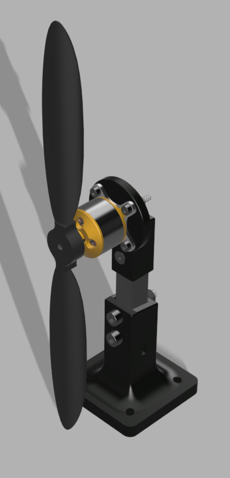
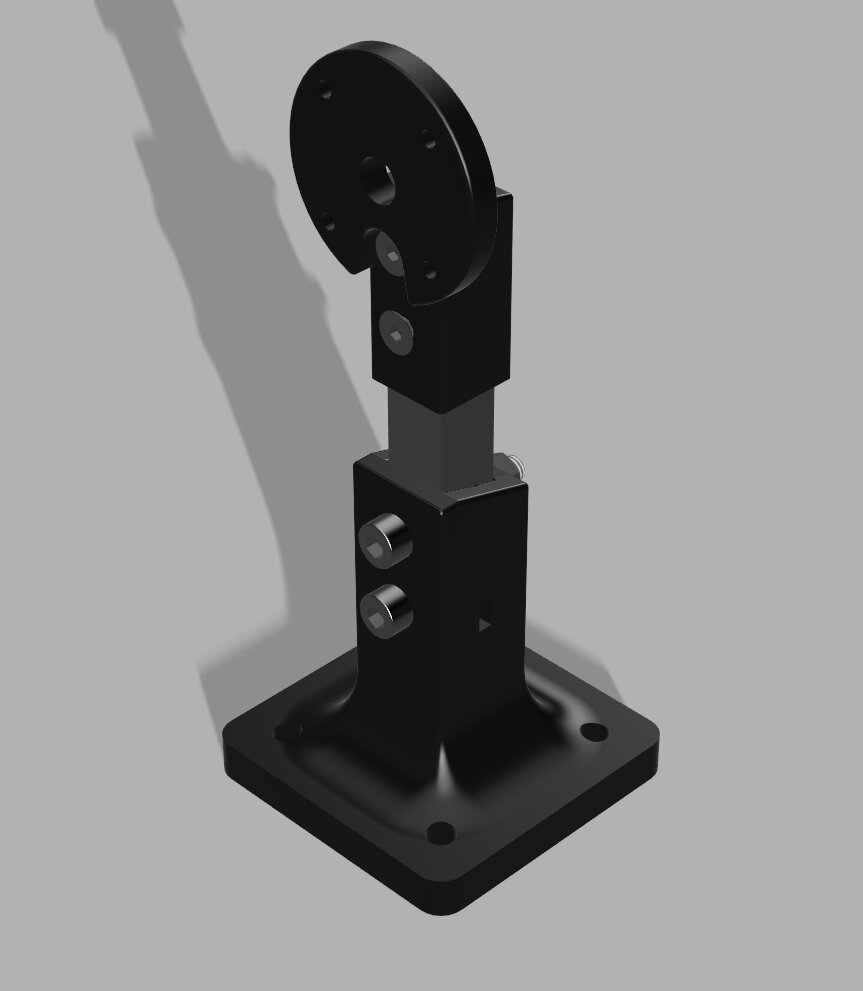

# 🚁 Digital Twin Framework for Real-Time Rotor Thrust & Power Monitoring in DEP Systems

<div style="display: flex; align-items: flex-start; gap: 10px;">
  
  
</div>

A real-time, bidirectional **Cyber-Physical Digital Twin** designed to evaluate Distributed Electric Propulsion (DEP) units for Electric Vertical Takeoff and Landing (eVTOL) aircraft. Built upon the **ISO 23247 reference architecture**, this framework links a 100% 3D-printed horizontal cantilever thrust stand to a Python analytics engine for live aerodynamic profiling and multi-rotor scaling.

---

## ⚡ Key Engineering Highlights

* **Bidirectional Cyber-Physical Loop:** Streams synchronized 50Hz thrust and electrical telemetry (Uplink) while sending live JSON throttle, tare, and calibration commands back to the physical motor without rebooting the microcontroller (Downlink).
* **Custom 32A Hardware Modification (`R100` → `R010`):** Replaces the factory 0.1Ω shunt resistor on the CJMCU-219 (INA219) module with a **0.01Ω 3W SMD2512 sense resistor**, reducing thermal dissipation at 15A from 22.5W to 2.25W and expanding the current ceiling from 3.2A to 32A.
* **100% 3D-Printed Horizontal Cantilever Rig:** Custom CAD-designed PLA Bottom Stand (`60x60mm` base) and horizontal Motor Mount eliminate metallic frame resonance and apply thrust perpendicular to the 5kg load cell for clean cantilever bending measurements.
* **Live Polynomial Regression & 5 FPS UI Throttler:** Uses `NumPy` 2nd-degree polynomial regression (`np.polyfit`) and `Plotly` dual-axis dark-mode charts to map thrust and system efficiency (`g/W`) curves in real time without browser lag.

---

## 🛠️ Hardware Architecture & Bill of Materials

| Subsystem | Component / Specification |
| :--- | :--- |
| **Microcontroller** | ESP32-WROOM-32 38-Pin Dual-Core Development Board |
| **Propulsion** | A2212 1000KV BLDC Outrunner Motor + 30A ESC + 1045 Propeller |
| **Power Supply** | 12V 25A (300W) Industrial SMPS + 12AWG Silicone Power Routing |
| **Thrust Sensing** | 5kg Straight-Bar Aluminum Load Cell (`80x12.7x12.7mm`) + HX711 24-Bit ADC |
| **Power Sensing** | CJMCU-219 (INA219) I2C Sensor (Modified with 0.01Ω 3W SMD2512 Shunt) |
| **Structure** | Custom FDM 3D-Printed PLA Bottom Stand & Cantilever Motor Mount |

### Pinout & Wiring Configuration
* **High-Current Rail (12AWG):** `SMPS V+` → `INA219 VIN+` | `INA219 VIN-` → `ESC V+` | `SMPS V-` → `ESC V-`
* **Logic Power (3.3V):** `ESP32 3V3` → `HX711 VCC` & `INA219 VCC` *(ESC 5V BEC `+ve` is isolated/disconnected to protect 3.3V ESP32 GPIO pins)*
* **Common Ground:** `SMPS V-` / `ESC -ve` → `ESP32 GND`, `HX711 GND`, `INA219 GND`
* **HX711 Telemetry:** `DT` → `GPIO 4` | `SCK` → `GPIO 5`
* **INA219 Telemetry (I2C):** `SDA` → `GPIO 21` | `SCL` → `GPIO 22`
* **ESC PWM Signal:** `SIGNAL` → `GPIO 18` (50Hz, 16-bit timer)

---

# 🛠️ Complete Build, Wiring & Execution Guide

Follow this end-to-end step-by-step guide to assemble the physical test stand, wire the high-current and 3.3V logic circuits, flash the ESP32 edge firmware, and run the live Digital Twin analytics engine.

---

## Phase 1: Current Sensor Hardware Modification (`R100` → `R010`)

Before wiring the power rail, the stock **INA219 DC Current Sensor Module** must be modified to handle the high current draw (12A–15A+) of the A2212 BLDC motor without thermal burnout[cite: 7].

1. **Locate the Factory Shunt:** Secure the CJMCU-219 (`INA219`) module in a PCB holder and identify the surface-mount `R100` (0.1 Ω) shunt resistor across the `VIN+` and `VIN-` pads[cite: 7].
2. **Desolder the `R100` Resistor:** Apply flux to both pads of the `R100` resistor and remove it using a hot-air rework station or a wide chisel-tip soldering iron. Clean the pads with solder wick.
3. **Solder the `R010` Sense Resistor:** Position a **0.01 Ω (R010) 3W SMD2512 sense resistor** across the pads and solder both ends to form solid thermal fillets. This reduces heat dissipation by 10x ($P = I^2R$) and raises the readable current limit from 3.2A to **32A**.
4. **Verify Continuity:** Use a digital multimeter in continuity/resistance mode across `VIN+` and `VIN-` to confirm a clean joint and ensure no adjacent I2C pins (`SDA`, `SCL`, `VCC`, `GND`) are bridged[cite: 7].

---

## Phase 2: 3D-Printed Mechanical Cantilever Assembly

All structural components are 3D-printed in **PLA** (50%+ infill recommended) to dampen high-frequency motor vibrations and apply horizontal thrust perpendicular to the load cell for clean cantilever bending measurements[cite: 8, 9].

| Item | Part Name | Part Number / Standard | Material | Qty |
| :--- | :--- | :--- | :--- | :--- |
| **1** | 5kg Straight-Bar Load Cell (`80x12.7x12.7mm`)[cite: 8, 10] | `2026-09-26-17-26-46-482`[cite: 8] | Steel / Aluminum[cite: 8] | 1[cite: 8] |
| **2** | Bottom Stand (`60x60mm` Base, `68mm` Height)[cite: 8, 11] | `2026-09-24-18-45-20-759`[cite: 8] | PLA[cite: 8] | 1[cite: 8] |
| **3** | Upper Load Cell Bolts (`M5x0.8 x 30mm`)[cite: 8] | `BSHCS ANSI B18.3.1M - M5x0.8 x 30`[cite: 8] | Steel Grade 2[cite: 8] | 2[cite: 8] |
| **4** | Horizontal Motor Mount (`63.03mm` Height, `Ø42mm` Face)[cite: 8, 12] | `2026-09-26-16-22-31-044`[cite: 8] | PLA[cite: 8] | 1[cite: 8] |
| **5** | Lower Base Pillar Bolts (`M4 x 25mm`)[cite: 8] | `BHSFCHCS ANSI B18.3.5M - M4x25`[cite: 8] | Steel Grade 2[cite: 8] | 2[cite: 8] |
| **6** | Lower Hex Nuts (`M4 x 0.7`)[cite: 8] | `DIN 934 M4 x 0.7`[cite: 8] | Steel 6[cite: 8] | 2[cite: 8] |
| **7** | Upper Hex Nuts (`M5 x 0.8`)[cite: 8] | `HNS2 ANSI B18.2.4.2M - M5x0.8`[cite: 8] | Steel Grade 2H[cite: 8] | 2[cite: 8] |

1. **Anchor the Bottom Stand:** Place the 3D-printed PLA **Bottom Stand** (`60x60mm` base plate, `8mm` base thickness, `R15` transition fillet) on the edge of a sturdy workbench and clamp it down using heavy-duty C-clamps[cite: 9, 11].
2. **Mount the Load Cell (Fixed Base End):** Insert the lower end of the `80mm` **Load Cell** vertically into the rectangular pocket (`12.9mm` width) of the Bottom Stand[cite: 10, 11]. Align the lower holes and secure tightly using two **M4x25 bolts** and two **M4 hex nuts**[cite: 8, 9, 10, 11].
3. **Attach the Horizontal Motor Mount (Floating End):** Fit the square sleeve (`12.9x12.9mm` inner pocket) of the PLA **Motor Mount** over the upper floating end of the vertical load cell[cite: 9, 12]. Secure it through the `Ø5.5mm` load cell holes using two **M5x30 bolts** and two **M5 hex nuts** to reach the full assembled height of `152.03mm` (`123.03mm` to the motor shaft centerline)[cite: 8, 9, 10, 12].
4. **Mount the BLDC Motor:** Bolt the **A2212 1000KV BLDC motor** sideways onto the `Ø42mm` circular face of the Motor Mount using the `Ø3mm` mounting holes (`Ø8mm` center shaft clearance hole)[cite: 9, 12].

> [!IMPORTANT]
> **Do NOT attach the 1045 propeller yet.** Complete all electrical wiring and initial ESC arming checks with an unloaded motor shaft first.

---

## Phase 3: High-Current & 3.3V Logic Wiring

Wire the system according to **Main Schematic DTI (V1.0)** and the **38-Pin ESP32-WROOM-32** pinout[cite: 1, 4, 7].

```text
[12V 25A SMPS] 
   ├── V+ (12AWG Red) ──► [INA219 VIN+] ──► [INA219 VIN-] ──(12AWG Red)──► [30A ESC V+]
   └── V- (12AWG Black) ─────────────────────────────────────────────────► [30A ESC V-]
                                                                                │
[ESP32-WROOM-32 (38-Pin)]                                                       ├─► BLDC 1, 2, 3
   ├── 3V3 (Pin 1)  ────► [HX711 VCC] & [INA219 VCC]                            │
   ├── GND (Pin 14) ────► [HX711 GND] & [INA219 GND] & [30A ESC -ve (Pin 6)] ◄──┘
   ├── G18 (Pin 28) ────► [30A ESC SIGNAL (Pin 4)]  (Note: ESC +ve 5V BEC is DISCONNECTED)
   ├── G4  (Pin 32) ────► [HX711 DT  (Pin 2)]
   ├── G5  (Pin 29) ────► [HX711 SCK (Pin 3)]
   ├── G21 (Pin 25) ────► [INA219 SDA (Pin 3)]
   └── G22 (Pin 22) ────► [INA219 SCL (Pin 4)]
```

1. **High-Current Power Path (Use 12AWG Silicone Wire Only):**
   * Solder a **12AWG Red wire** from the `12V 25A (300W) SMPS` `V+` (Pin 2) terminal to `VIN+` (Pin 7) on the modified `INA219` module[cite: 7].
   * Solder a **12AWG Red wire** from `VIN-` (Pin 8) on the `INA219` module to the main positive input `V+` (Pin 7) of the `ESC 30A`[cite: 7].
   * Solder a **12AWG Black wire** directly from the SMPS `V-` (Pin 1) terminal to the main negative input `V-` (Pin 8) of the `ESC 30A`[cite: 7].
   * Connect the three motor phase wires (`BLDC 1`, `BLDC 2`, `BLDC 3`) from the `ESC 30A` to the A2212 motor leads[cite: 7].
2. **3.3V Logic Power & Common Ground:**
   * Connect `3V3` (`3.3V`, Pin 1) on the 38-pin ESP32 to `VCC` (Pin 4) on the `HX711` module and `VCC` (Pin 6) on the `INA219` module[cite: 4, 7].
   * Connect `GND` (Pin 14) on the ESP32 to `GND` (Pin 1) on the `HX711`, `GND` (Pin 5) on the `INA219`, and `-ve` (Pin 6) on the `ESC 30A` to establish a common ground reference[cite: 4, 7].

> [!CAUTION]
> **Isolate the ESC 5V BEC (`+ve`):** Leave Pin 5 (`+ve` / `+5V`) on the `ESC 30A` completely disconnected[cite: 7]. The ESP32 operates strictly at **3.3V logic**; powering the sensors with 5V from the ESC will send 5V signals into the ESP32 data pins and permanently damage the microcontroller[cite: 6, 7].

3. **Sensor & PWM Data Connections:**
   * **30A ESC Signal:** Connect `SIGNAL` (Pin 4) to ESP32 `G18` / `P18` (`GPIO18`, Pin 28)[cite: 4, 7].
   * **HX711 24-Bit ADC Module:** Connect `DT` (Pin 2) to ESP32 `G4` / `P4` (`GPIO4`, Pin 32) and `SCK` (Pin 3) to ESP32 `G5` / `P5` (`GPIO5`, Pin 29)[cite: 4, 7].
   * **INA219 Current Sensor:** Connect `SDA` (Pin 3) to ESP32 `G21` / `P21` (`GPIO21`, Pin 25) and `SCL` (Pin 4) to ESP32 `G22` / `P22` (`GPIO22`, Pin 22)[cite: 4, 7].

> [!NOTE]
> Avoid connecting any wires to the bottom flash pins (`CMD`, `SD0`–`SD3`, `CLK` / `GPIO6`–`GPIO11`) on the 38-pin ESP32 board, as doing so will prevent the microcontroller from booting[cite: 4, 7].

---

## Phase 4: Flashing the ESP32 Edge Firmware

1. **Clone the Repository:**
   ```bash
   git clone [https://github.com/](https://github.com/)MechEngineerDhruv/dep-evtol-digital-twin.git
   cd dep-evtol-digital-twin
   ```
2. **Configure the Arduino IDE:**
   * Open `DTI_Main_Code_ESP32_New/DTI_Main_Code_ESP32_New.ino` in the Arduino IDE.
   * Go to **Tools > Board > Boards Manager**, search for `esp32` by **Espressif Systems**, and install version **3.x.x** (uses the updated `ledcAttach(ESC_PIN, 50, 16)` API).
   * Select **Tools > Board > esp32 > ESP32 Dev Module** for the 38-pin `ESP32-WROOM-32` board[cite: 1, 2, 5].
3. **Install Required Arduino Libraries:**
   * Open **Tools > Manage Libraries** and install:
     * `Adafruit INA219`
     * `HX711_ADC`
     * `ArduinoJson` (v6.x)
4. **Flash the Microcontroller:**
   * Plug the ESP32 into your computer using the onboard **Micro-USB** port[cite: 5].
   * Select the active COM port under **Tools > Port** (e.g., `COM3`) and click **Upload**.

> [!TIP]
> If the Arduino IDE console stalls at `Connecting...`, press and hold the physical **BOOT** tactile button next to the Micro-USB port on your ESP32 board for 1–2 seconds until the upload begins[cite: 5].

---

## Phase 5: Launching the Python Digital Twin Dashboard

1. **Create a Virtual Environment (Optional):**
   ```bash
   python -m venv venv
   # Windows:
   venv\Scripts\activate
   # macOS / Linux:
   source venv/bin/activate
   ```
2. **Install Python Dependencies:**
   ```bash
   pip install streamlit pyserial pandas numpy plotly
   ```
3. **Start the Analytics Engine:**
   ```bash
   streamlit run Main_Code_4.py
   ```
4. The dashboard will automatically launch in your default browser at `http://localhost:8501`.

---

## Phase 6: Calibration & Live Testing Protocol

### Step 1: Dry Run & ESC Arming (No Propeller)
1. Ensure the 1045 propeller is **removed**.
2. Connect the ESP32 to your PC via USB, then switch ON the **12V 25A SMPS**[cite: 7].
3. Press the onboard **EN (`RESET`)** button on the ESP32[cite: 4, 5]. Wait **3 seconds** for the ESC to emit its 3-beep initialization chime, confirming it has locked onto the `1000 µs` (`3276` 16-bit duty cycle) arming signal.
4. In the Streamlit sidebar, enter your **COM Port** (`COM3`), verify the baud rate is set to `115200`, and click **▶️ Start Telemetry Link**.
5. Confirm that the **Electrical Health** chart displays a steady `~12.00 V` bus voltage and `0.00 A` current.
6. Gently slide **Throttle Override (PWM)** to `1150` to verify smooth motor rotation, then return the slider to `1000` and click **⏹️ Stop Link**.

### Step 2: Load Cell Taring & Calibration
1. With the motor stopped (`1000 PWM`), click **▶️ Start Telemetry Link**.
2. Click **Zero / Tare Scale** in the sidebar and wait 2 seconds for the **Thrust (g)** KPI card to settle at `0.0 g` (a hardware safety lock blocks taring whenever PWM > 1000).
3. Enter your empirical load cell multiplier into the **Calibration Factor** input box. Because the motor is mounted horizontally on a vertical cantilever stand, negate the value (e.g., `-214.50` instead of `214.50`) if forward pull registers as negative thrust[cite: 9].

### Step 3: Propeller Installation (Tractor / Pull Orientation)
1. Switch OFF the **12V 25A SMPS**[cite: 7].
2. Mount the **1045 polymer propeller** onto the A2212 shaft with the printed numbers facing **outward** (away from the vertical pillar)[cite: 9, 12].
3. Verify that spinning the motor blows prop-wash **backward over the PLA Motor Mount and Bottom Stand**, pulling the cantilever forward (Tractor Configuration) to capture real-world aerodynamic downwash blockage[cite: 9, 11, 12]. *(If air blows forward away from the stand, swap any two of the three `BLDC 1/2/3` phase wires between the ESC and motor to reverse rotation[cite: 7]).*

### Step 4: Dynamic Throttle Sweeps & Polynomial Regression
> [!WARNING]
> Double-check that the `60x60mm` PLA base is tightly C-clamped to the workbench and stand clear of the rotational plane of the propeller before energizing the SMPS[cite: 9, 11].

1. Switch ON the **12V 25A SMPS** and click **▶️ Start Telemetry Link**[cite: 7].
2. Incrementally step the **Throttle Override (PWM)** slider from `1000` toward `2000` in `50–100 µs` intervals.
3. Observe the four real-time Plotly analytics panels updating at 5 FPS over the 50Hz serial stream:
   * **Transient Response (Top Left):** Tracks aerodynamic spool-up lag between **Thrust (g)** and **Power (W)**.
   * **Electrical Health (Top Right):** Monitors high-current draw (**Amps**) against SMPS voltage stability (**Volts**).
   * **Aerodynamic Profile (Bottom Left):** Plots raw 50Hz PWM-vs-Thrust scatter data and automatically fits a live **2nd-degree NumPy polynomial regression curve** (`np.polyfit`) once >3 unique PWM setpoints are recorded.
   * **System Efficiency Profile (Bottom Right):** Maps grams of thrust per Watt (`g/W`) with a live quadratic trendline to visualize high-RPM efficiency drop-off.
4. **Emergency Disarm:** If abnormal vibration occurs at any point, click the red **🚨 EMERGENCY STOP** button in the sidebar to immediately transmit a `1000 µs` kill packet (`{"pwm": 1000, "cal": 1.0, "tare": 0}`) and disarm the motor.
