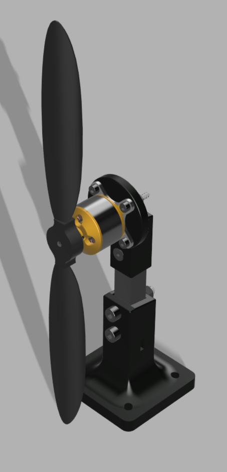
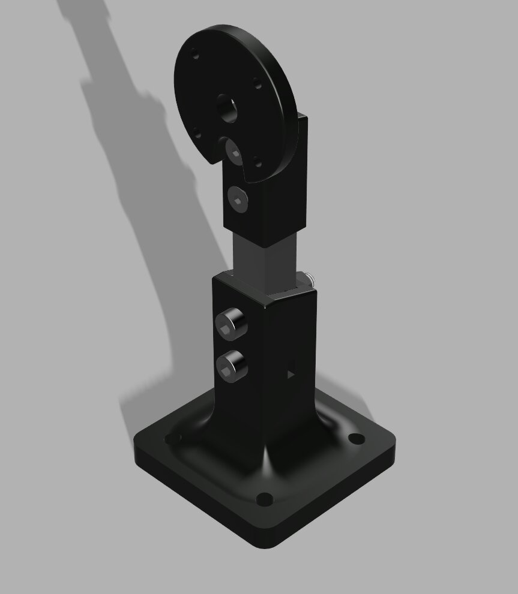
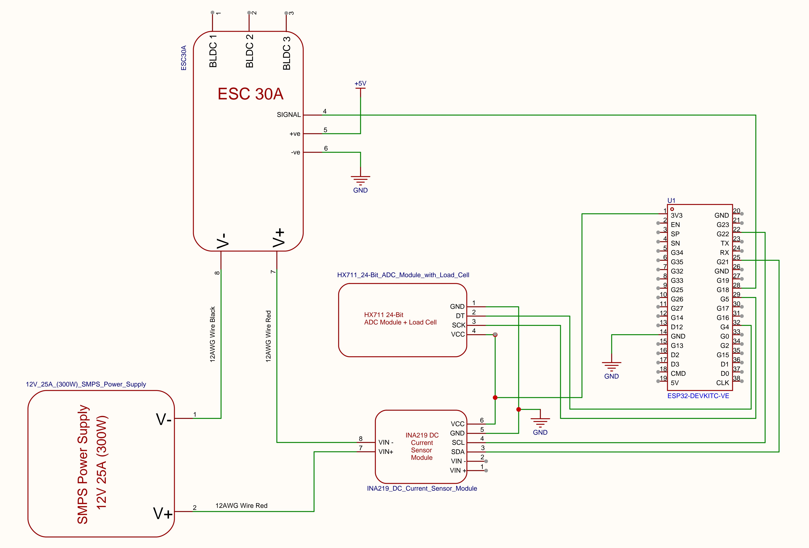

# 🚁 Digital Twin Framework for Real-Time Rotor Thrust & Power Monitoring in DEP Systems

<div style="display: flex; align-items: flex-start; gap: 10px;">
  
  
</div>

A real-time, bidirectional **Cyber-Physical Digital Twin** designed to evaluate Distributed Electric Propulsion (DEP) units for Electric Vertical Takeoff and Landing (eVTOL) aircraft. Built upon the **ISO 23247 reference architecture**, this framework links a 100% 3D-printed horizontal cantilever thrust stand to a Python analytics engine and Ansys Twin Builder for live aerodynamic profiling, Reduced Order Model (ROM) co-simulation, and multi-rotor scaling.

---

## ⚡ Key Engineering Highlights

- **Bidirectional Cyber-Physical Loop:** Streams synchronized 50Hz thrust and electrical telemetry (Uplink) while sending live JSON throttle, tare, and calibration commands back to the physical motor without lagging the UI. Includes persistent cached serial objects to prevent Windows COM port `PermissionError 13` locks.
- **Ansys Twin Builder Co-Simulation via MQTT:** A background thread-safe MQTT bridge (Mosquitto) streams physical telemetry to Ansys Twin Builder, which returns real-time Reduced Order Model (ROM) predictions (e.g., motor temperature and theoretical thrust) directly to the Streamlit dashboard.
- **Custom 32A Hardware Modification (`R100` → `R010`):** Replaces the factory 0.1Ω shunt resistor on the CJMCU-219 (INA219) module with a **0.01Ω 3W SMD2512 sense resistor**, reducing thermal dissipation at 15A from 22.5W to 2.25W and expanding the current ceiling from 3.2A to 32A.
- **100% 3D-Printed Horizontal Cantilever Rig:** Custom CAD-designed PLA Bottom Stand (`60x60mm` base) and horizontal Motor Mount eliminate metallic frame resonance and apply thrust perpendicular to the 5kg load cell for clean cantilever bending measurements.
- **Automated Missions & Seaborn Stats:** Features a pre-programmed Autonomous Hover Cycle state machine for hands-free testing, alongside a live 1-FPS Seaborn correlation heatmap and regression statistical suite.

---

## 🛠️ Hardware Architecture & Bill of Materials

| Subsystem | Component / Specification |
| :--- | :--- |
| **Microcontroller** | ESP32-WROOM-32 38-Pin Dual-Core Development Board |
| **Propulsion** | A2212 1000KV BLDC Outrunner Motor + 30A ESC + 1045 Propeller |
| **Power Supply** | 12V 25A (300W) Industrial SMPS (AC Grounded) |
| **Safety** | 20A 12V Heavy-Duty Illuminated Toggle Switch (with safety cover) |
| **Thrust Sensing** | 5kg Straight-Bar Aluminum Load Cell (`80x12.7x12.7mm`) + HX711 24-Bit ADC |
| **Power Sensing** | CJMCU-219 (INA219) I2C Sensor (Modified with 0.01Ω 3W SMD2512 Shunt) |
| **Structure** | Custom FDM 3D-Printed PLA Bottom Stand & Cantilever Motor Mount |

### Pinout & Wiring Configuration



```text
[AC Mains Wall Power] 
   ├── Live (L), Neutral (N), & Earth (E) ──► [12V 25A SMPS Input] (Earth required for safety/EMI reduction)

[12V 25A SMPS Output] 
   ├── V+ (12AWG) ──► [20A Toggle Switch Pin 1] ──► [Switch Pin 2] ──► [INA219 VIN+] ──► [INA219 VIN-] ──► [30A ESC V+]
   └── V- (12AWG) ────────────────┬────────────────────────────────────────────────────────────────────────► [30A ESC V-]
                                  └──► [20A Toggle Switch Pin 3] (LED Ground)                                   │
[ESP32-WROOM-32 (38-Pin)]                                                                                       ├─► BLDC 1, 2, 3
   ├── 3V3 (Pin 1)  ────► [HX711 VCC] & [INA219 VCC]                                                            │
   ├── GND (Pin 14) ────► [HX711 GND] & [INA219 GND] & [30A ESC -ve (Pin 6)] ◄──────────────────────────────────┘
   ├── G18 (Pin 28) ────► [30A ESC SIGNAL (Pin 4)]  (Note: ESC +ve 5V BEC is DISCONNECTED)
   ├── G4  (Pin 32) ────► [HX711 DT  (Pin 2)]
   ├── G5  (Pin 29) ────► [HX711 SCK (Pin 3)]
   ├── G21 (Pin 25) ────► [INA219 SDA (Pin 3)]
   └── G22 (Pin 22) ────► [INA219 SCL (Pin 4)]
```

---

# 🛠️ Complete Build, Wiring & Execution Guide

Follow this end-to-end step-by-step guide to assemble the physical test stand, wire the high-current and 3.3V logic circuits, flash the ESP32 edge firmware, and run the live Digital Twin analytics engine.

---

## Phase 1: Current Sensor Hardware Modification (`R100` → `R010`)

Before wiring the power rail, the stock **INA219 DC Current Sensor Module** must be modified to handle the high current draw (12A–15A+) of the A2212 BLDC motor without thermal burnout.

1. **Locate the Factory Shunt:** Secure the CJMCU-219 (`INA219`) module in a PCB holder and identify the surface-mount `R100` (0.1 Ω) shunt resistor across the `VIN+` and `VIN-` pads.
2. **Desolder the `R100` Resistor:** Apply flux to both pads of the `R100` resistor and remove it using a hot-air rework station or a wide chisel-tip soldering iron. Clean the pads with solder wick.
3. **Solder the `R010` Sense Resistor:** Position a **0.01 Ω (R010) 3W SMD2512 sense resistor** across the pads and solder both ends to form solid thermal fillets. This reduces heat dissipation by 10x ($P = I^2R$) and raises the readable current limit from 3.2A to **32A**.
4. **Verify Continuity:** Use a digital multimeter in continuity/resistance mode across `VIN+` and `VIN-` to confirm a clean joint and ensure no adjacent I2C pins are bridged.

---

## Phase 2: 3D-Printed Mechanical Cantilever Assembly

All structural components are 3D-printed in **PLA** (50%+ infill recommended) to dampen high-frequency motor vibrations and apply horizontal thrust perpendicular to the load cell.

1. **Anchor the Bottom Stand:** Place the 3D-printed PLA **Bottom Stand** on the edge of a sturdy workbench and clamp it down using heavy-duty C-clamps.
2. **Mount the Load Cell (Fixed Base End):** Insert the lower end of the `80mm` **Load Cell** vertically into the rectangular pocket of the Bottom Stand. Align the lower holes and secure tightly using two **M4x25 bolts** and two **M4 hex nuts**.
3. **Attach the Horizontal Motor Mount (Floating End):** Fit the square sleeve of the PLA **Motor Mount** over the upper floating end of the vertical load cell. Secure it using two **M5x30 bolts** and two **M5 hex nuts**.
4. **Mount the BLDC Motor:** Bolt the **A2212 1000KV BLDC motor** sideways onto the circular face of the Motor Mount using the `Ø3mm` mounting holes.

> [!IMPORTANT]
> **Do NOT attach the 1045 propeller yet.** Complete all electrical wiring and initial ESC arming checks with an unloaded motor shaft first.

---

## Phase 3: High-Current, Safety Switch & 3.3V Logic Wiring

1. **AC Mains Power (SMPS Input):** Ensure Live (L), Neutral (N), and **Earth/Ground** are connected to your SMPS. Earth is mandatory to prevent the aluminum chassis from becoming live and to filter ESC PWM noise.
2. **High-Current Power Path (12AWG) & Toggle Switch:**
   * Break the Positive 12V line with the **20A Toggle Switch**. Connect SMPS `V+` to the switch Input, and the switch Output to INA219 `VIN+`. 
   * Connect the third offset pin on the toggle switch to the SMPS `V-` Ground rail to enable the red LED tip illumination.
   * Route INA219 `VIN-` to the `ESC 30A` positive input. Connect the SMPS `V-` directly to the ESC negative input.
3. **3.3V Logic Power & Common Ground:**
   * Connect `3V3` on the 38-pin ESP32 to `VCC` on the `HX711` and `INA219`.
   * Tie `GND` on the ESP32 to `GND` on the sensors and `-ve` on the `ESC` to establish a common ground reference.

> [!CAUTION]
> **Isolate the ESC 5V BEC (`+ve`):** Leave Pin 5 (`+ve` / `+5V`) on the `ESC 30A` completely disconnected. The ESP32 operates strictly at **3.3V logic**; 5V will permanently damage the microcontroller.

4. **Sensor Data Connections:**
   * **ESC Signal:** Connect to `GPIO18`.
   * **HX711:** `DT` to `GPIO4`, `SCK` to `GPIO5`.
   * **INA219:** `SDA` to `GPIO21`, `SCL` to `GPIO22`.

---

## Phase 4: Flashing the ESP32 Edge Firmware

1. **Clone the Repository:**
   ```bash
   git clone https://github.com/MechEngineerDhruv/dep-evtol-digital-twin.git
   cd dep-evtol-digital-twin
   ```
2. **Configure the Arduino IDE:** Select **ESP32 Dev Module** (Core v3.x.x required for the updated LEDC API).
3. **Install Libraries:** `Adafruit INA219`, `HX711_ADC`, and `ArduinoJson` (v6.x).
4. **Flash:** Upload the firmware. Close the Arduino Serial Monitor completely when done to free the `COM` port.

---

## Phase 5: Digital Twin Software Setup (Python, MQTT, & Ansys)

1. **Install Python Dependencies:**
   ```bash
   pip install streamlit pyserial pandas numpy plotly seaborn paho-mqtt
   ```
2. **Start the MQTT Broker:** Ensure **Eclipse Mosquitto** is running in the background. If running Ansys Twin Builder on a separate PC via Ethernet/Tailscale, ensure your `mosquitto.conf` includes `listener 1883 0.0.0.0` and `allow_anonymous true`.
3. **Start the Analytics Engine:**
   ```bash
   streamlit run app.py
   ```

---

## Phase 6: Calibration & Live Testing Protocol

### Step 1: Dry Run & ESC Arming (No Propeller)
1. With the 1045 propeller **removed**, plug in the ESP32 USB and power the 12V SMPS.
2. **Arm the Motor:** Flip the 20A toggle switch ON (red tip illuminates). Wait 3 seconds for the ESC's 3-beep chime and long solid arming tone.
3. In Streamlit, enter your COM port and hit **🔌 Connect to ESP32**, verify your MQTT Broker, and click **▶️ Start Link**.
4. Test the slider gently to ensure the motor spins, then return to 1000 PWM.

### Step 2: Load Cell Calibration
1. With the motor stopped, click **Zero / Tare Scale**. Wait 2 seconds.
2. Enter your predetermined empirical load cell multiplier into the **Calibration Factor** input box (use a negative value if forward thrust reads negatively due to cantilever orientation).

### Step 3: Propeller Installation (Tractor Configuration)
1. Flip the 20A switch **OFF**.
2. Mount the 1045 propeller with numbers facing **outward** (away from the stand). Verify rotation pulls air backward over the mount to capture realistic aerodynamic downwash blockage.

### Step 4: Digital Twin Co-Simulation & Dashboard
1. Hit **▶️ Start Link**. Ensure Ansys Twin Builder is running on the network to populate the ROM Co-Sim KPIs.
2. **Manual Sweeps:** Step the Throttle slider to generate a live 2nd-degree NumPy regression curve and Seaborn multi-variate statistical heatmaps. 
3. **Autonomous Missions:** Click **▶️ Run Hover Cycle Test** to watch the Python state-machine autonomously execute a Spool-up ➔ Hover ➔ Descent sequence while predicting 8-Rotor eVTOL lifting capacities.
4. **Emergency E-Stop:** If extreme resonance occurs, slap the 20A Toggle Switch down or hit the **🚨 EMERGENCY STOP** button in the UI to instantly kill the motor.
